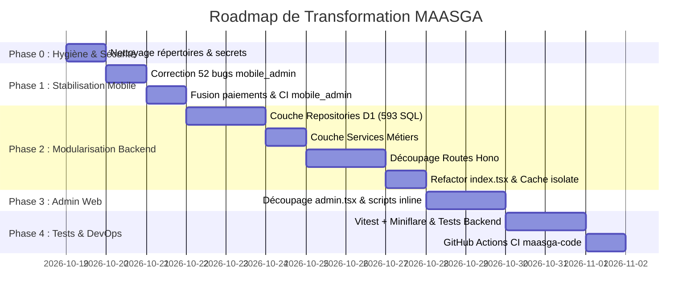

# Feuille de Route Opérationnelle (Roadmap) — Système MAASGA

**Objectif :** Éliminer la dette technique, sécuriser les applications, modulariser le backend Hono et fiabiliser les deux applications mobiles Flutter sans interruption de service.

---

## Vue d'Ensemble & Chronogramme Estimé

---

## Phase 0 : Nettoyage d'Urgence & Sécurité (Jour 1)

Cette phase prépare le terrain sans modifier la logique applicative.

### Tâches opérationnelles :
- [ ] **P0.1 — Nettoyage des répertoires malformés et logs volumineux** :
  - Supprimer les faux dossiers Windows à la racine de `maasga-code` : `CUserssaytaDownloadsTelegram`, `Desktopmaasga-codesrccomponentsadmin`, `Desktopmaasga-codesrchooks`.
  - Supprimer les crash logs Java/Gradle de 1.3 Mo : `hs_err_pid3860.log`, `replay_pid3860.log`.
  - Supprimer les logs de compilation mobiles : `maasga-mobile/build.log`, `maasga-mobile/build2.log` (3 Mo).
  - Nettoyer les doublons de scripts de déploiement orphelins : `deploy-wrapper.bat`, `deploy.bat`, `deploy.ps1`, `deploy-output.txt`.
- [ ] **P0.2 — Sécurisation des credentials** :
  - Supprimer définitivement le fichier `secrets_tmp.json` contenant `ADMIN_SECRET` en clair.
  - Supprimer les fichiers `google-services (*).json` orphelins à la racine des projets et conserver uniquement ceux placés dans `android/app/`.
  - Vérifier que `.gitignore` couvre strictement `*.json` de secrets, `.env`, `*.jks` et `*.log`.
- [ ] **P0.3 — Point de sauvegarde Git** :
  - Créer une branche de travail dédiée : `git checkout -b refactor/system-overhaul`.

---

## Phase 1 : Stabilisation des Applications Mobiles Flutter (Jours 2 - 3)

### Tâches opérationnelles :
- [ ] **P1.1 — Élimination des 52 avertissements dans `mobile_admin`** :
  - **Priorité absolue :** Corriger les violations de `use_build_context_synchronously` dans :
    - `features/sav/presentation/screens/sav_screen.dart`
    - `features/sav/presentation/screens/sav_detail_screen.dart`
    - `features/realisations/presentation/screens/realisations_screen.dart`
    - `features/products/presentation/screens/products_screen.dart`
    - `features/products/presentation/screens/mediatheque_screen.dart`
    *(Ajout de `if (!mounted) return;` ou capture préalable du Navigator/Messenger).*
  - **Mise à niveau des composants dépréciés :**
    - Remplacer `Radio`/`RadioListTile` (`groupValue`, `onChanged`) par `RadioGroup` conforme à Flutter 3.32+.
- [ ] **P1.2 — Unification des modules paiements dans `mobile_admin`** :
  - Supprimer le dossier coquille vide `mobile_admin/lib/features/paiements/`.
  - Re-router tous les imports vers `mobile_admin/lib/features/payments/`.
- [ ] **P1.3 — Mise en place de la CI pour `mobile_admin`** :
  - Créer `.github/workflows/mobile-admin-ci.yml` dans `maasga-code` pour lancer `flutter analyze` et `flutter test` à chaque modification de l'application admin mobile.

---

## Phase 2 : Modularisation & Refactorisation du Backend Hono (Jours 4 - 8)

Objectif : Transformer le fichier géant [`src/index.tsx`](file:///c:/Users/sayta/Downloads/Telegram%20Desktop/maasga-code/src/index.tsx) (13 788 lignes) en une architecture en couches maintenable et extensible.

### Étape 2.1 — Extraction de la couche Repositories (Accès D1)
Centraliser les **593 requêtes SQL** actuellement dispersées dans les routes vers des classes/fonctions dédiées et typées dans `src/repositories/` :
- [ ] `src/repositories/product.repository.ts` : CRUD produits, catégories, stocks, galerie.
- [ ] `src/repositories/order.repository.ts` : commandes, statut devis, historique.
- [ ] `src/repositories/appointment.repository.ts` : rendez-vous clim, créneaux horaires, techniciens.
- [ ] `src/repositories/maintenance.repository.ts` : demandes, contrats actifs, visites programmées, checklists.
- [ ] `src/repositories/sav.repository.ts` : tickets de dépannage, messages, statuts.
- [ ] `src/repositories/client.repository.ts` : profils clients, liaison `firebase_uid`.
- [ ] `src/repositories/banner.repository.ts` & `brand.repository.ts` : carrousel et médiathèque.

### Étape 2.2 — Extraction des Services Métiers
Isoler la logique business des contrôleurs HTTP dans `src/services/` :
- [ ] `src/services/pricing.service.ts` : extraction de `calculatePlanPricing()` et calculs de remises/TVA.
- [ ] `src/services/storage.service.ts` : encapsulation propre de Cloudflare R2 avec fallback et génération d'en-têtes HTTP de mise en cache.
- [ ] `src/services/auth.service.ts` : vérification JWT Firebase RS256, génération et révocation des tokens de session admin (`epoch`).
- [ ] `src/services/notification.service.ts` : envoi unifié Brevo (emails transactionnels), Telegram Bot et push notifications FCM.

### Étape 2.3 — Découpage des Contrôleurs & Routes Hono
Créer des sous-applications Hono modulaires montées avec `app.route(...)` dans `src/routes/` :
- [ ] `src/routes/web/` : pages vitrines SSR (`home`, `catalogue`, `produit`, `contact`, `mentions-legales`).
- [ ] `src/routes/admin-web/` : routes de rendu du panneau d'administration web.
- [ ] `src/routes/api-client/` : API espace client web (`/api/client/...`, devis, avis).
- [ ] `src/routes/api-mobile/` : API dédiée à l'app mobile client (`/api/mobile/...`).
- [ ] `src/routes/api-mobile-admin/` : API dédiée à l'app mobile admin (`/api/mobile/admin/...`).

### Étape 2.4 — Réduction du point d'entrée `src/index.tsx`
- [ ] Réduire `src/index.tsx` à **moins de 150 lignes** :
  - Configuration globale Hono.
  - Enregistrement des middlewares globaux (CORS, CSP, rate-limit, logging).
  - Montage des sous-routeurs `app.route(...)`.
- [ ] Remplacer le cache en mémoire locale d'isolate (`products = []`) par une stratégie d'interrogation directe D1 avec en-têtes Edge Cache Cloudflare (`stale-while-revalidate`) pour garantir la synchronisation instantanée entre PoPs.

---

## Phase 3 : Découpage de l'Admin Web (`src/pages/admin.tsx`) (Jours 9 - 10)

Le fichier `admin.tsx` fait **6 921 lignes** et contient 20 blocs de JavaScript inline.

### Tâches opérationnelles :
- [ ] **P3.1 — Découpage par composants d'onglets** :
  - Créer `src/components/admin/tabs/` :
    - `AdminProductsTab.tsx`
    - `AdminOrdersTab.tsx`
    - `AdminAppointmentsTab.tsx`
    - `AdminMaintenanceTab.tsx`
    - `AdminSavTab.tsx`
    - `AdminBannersTab.tsx`
    - `AdminClientsTab.tsx`
    - `AdminSettingsTab.tsx`
- [ ] **P3.2 — Externalisation des scripts JavaScript inline** :
  - Sortir le JavaScript brut des balises `<script>` de templates pour créer des fichiers JS modulaires dans `public/static/js/admin/` (ex: `admin-products.js`, `admin-maintenance.js`, `admin-charts.js`).
  - Gain : coloration syntaxique, validation linter, minification automatique au build, et politique CSP renforcée sans `'unsafe-inline'`.

---

## Phase 4 : Stratégie de Tests Automatisés & CI/CD Backend (Jours 11 - 12)

### Tâches opérationnelles :
- [ ] **P4.1 — Mise en place de Vitest et Miniflare** :
  - Installer `vitest` et `@cloudflare/vitest-pool-workers` dans `maasga-code`.
  - Mettre à jour le script `"test"` dans `package.json` (`"test": "vitest run"` au lieu de `"curl localhost"`).
- [ ] **P4.2 — Écriture des tests unitaires & d'intégration critiques** :
  - Test du moteur de calcul tarifaire (`calculatePlanPricing`).
  - Test de création de commande et recalcul du prix côté serveur.
  - Test de vérification des tokens admin et rejet des sessions révoquées.
  - Test de l'upload et de la lecture Cloudflare R2 (`/media/:key`).
- [ ] **P4.3 — Création de la pipeline CI/CD GitHub Actions pour `maasga-code`** :
  - Créer `.github/workflows/deploy.yml` :
    - Déclenchement sur push `main` et PRs.
    - Étape 1 : `npm run build` (Tailwind + Vite SSR).
    - Étape 2 : Exécution de la suite de tests Vitest.
    - Étape 3 : Déploiement automatique sur Cloudflare Pages via Wrangler GitHub Action.

---

## Phase 5 : Finalisation & Préparation Échelle (Jours 13+)

- [ ] **P5.1 — Clarification du modèle de paiement** :
  - Si paiement en ligne réactivé : concevoir un module de paiement unifié (ex: agrégateur CinetPay / FeexPay / Orange Money) avec webhook idempotente et validation en base D1.
- [ ] **P5.2 — Support iOS pour `maasga-mobile`** :
  - Si publication App Store souhaitée : initialiser le dossier `ios/`, configurer `Podfile`, bundle ID, certificats et Firebase iOS.
- [ ] **P5.3 — Documentation finale & guide développeur** :
  - Mettre à jour `README.md` et documenter l'architecture modulaire pour les futurs contributeurs.
